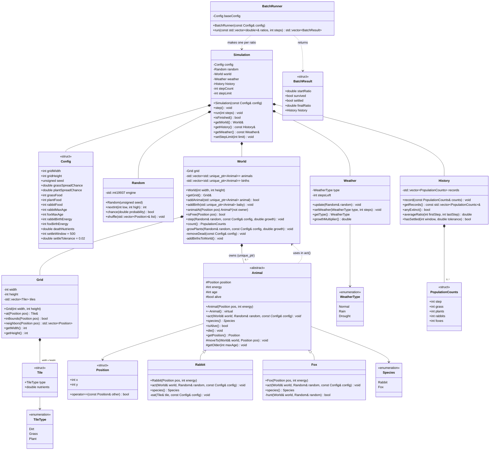
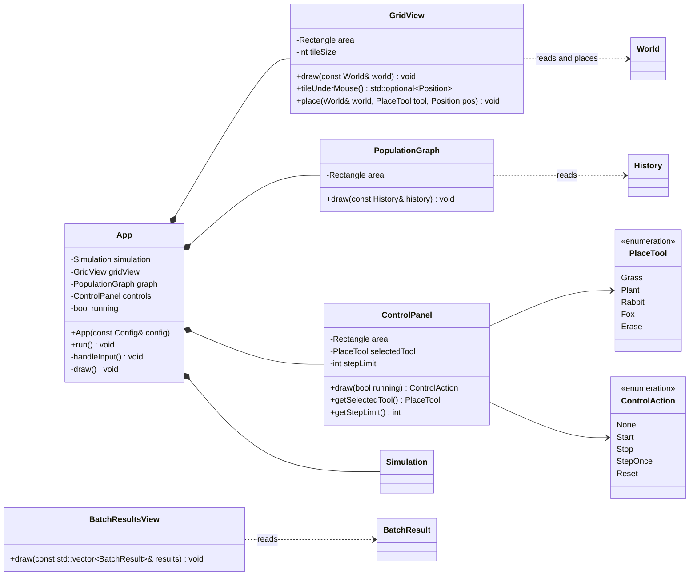

# Ecosystem Simulator: class design (draft)

This is the first draft of the UML class diagram. It follows the proposal.
Items marked **(open)** wait for a team decision. See "Open questions" at the end.

GitHub shows the diagrams below as pictures. In VS Code, use a Markdown
preview extension that supports Mermaid. PNG copies for the report are in
`docs/uml-core.png` and `docs/uml-gui.png`. If you change the Mermaid code,
make the PNGs again (for example with https://mermaid.live).

## Two layers

The code has two layers:

1. **core** (the `core` library in `CMakeLists.txt`): all simulation logic.
   It does not include `raylib.h`. The tests and batch mode use only this layer.
2. **gui** (the `app` program): raylib drawing and input. It reads from core
   and calls core functions. Core never calls the GUI.

This split is why we can test the rules without a window, and why batch mode
can run fast.

## Core layer

## GUI layer

## How to read the arrows

| Arrow | Name | Meaning in our code |
|---|---|---|
| `*--` (filled diamond) | composition | The class owns the part. The part is a member or a `unique_ptr`, and it is destroyed with the owner. |
| `<\|--` (hollow triangle) | inheritance | `Rabbit` and `Fox` are kinds of `Animal`. |
| `-->` | association | The class keeps or uses a value of that type. |
| `..>` (dashed) | dependency | The class uses the other class only as a function parameter or return value. It does not own it. |

In the class boxes: `+` is public, `-` is private, `#` is protected,
and a function in *italics* (written with `*` at the end in the Mermaid code) is pure virtual (`= 0`).

## Why the design looks like this

- **Inheritance only for animals.** Rabbits and foxes do the same kinds of
  things (move, eat, get older, have babies, die) but with different rules.
  `World` keeps one list of `Animal` pointers and calls `act()` on each one.
  This is the one place where polymorphism is needed.
- **Tiles are an enum, not classes.** A tile only holds data (type and
  nutrients). The grass and plant spread rules run in `World::growPlants`.
  A class for each tile type would add virtual calls on every tile, every
  step, for no gain.
- **Composition everywhere else.** `Simulation` has a `World`, a `Weather`,
  and a `History`. `World` has a `Grid`. These are plain members, so they are
  made and destroyed with their owner (RAII). No `new` or `delete`.
- **`std::unique_ptr<Animal>` in `World`.** We need pointers because the
  vector holds different types (`Rabbit`, `Fox`). `unique_ptr` says that the
  `World` is the only owner. When an animal is removed from the vector, it is
  deleted. `Animal` has a virtual destructor so the right destructor runs.
- **Raw `Animal*` only to look, never to own.** `animalAt()` returns a plain
  pointer (or `nullptr`). The caller must not delete it.
- **Births and deaths wait until the step ends.** Adding to or removing from
  `animals` while we loop over it can break the loop. During a step, a dead
  animal is only marked (`alive = false`), and a baby goes into `births`.
  After all animals act, `removeDead()` erases the dead ones (and adds
  nutrients to their tiles), then `addBirthsToWorld()` moves the babies in.
  This is the plan from the proposal's "Update order" challenge.
- **One `Random` with a seed.** All random choices use the same `Random`
  object. With the same seed, a run is the same every time, so tests can
  check exact results.
- **`Config` holds every number we tune.** Tests can make a small, simple
  config. Batch mode copies the base config and changes only the
  starting numbers.
- **The GUI only reads and calls.** `GridView::draw` takes a `const World&`,
  so the drawing code cannot change the simulation by mistake.

## One step, in order

`Simulation::step()`:

1. `weather.update(random)`
2. `world.step(random, config, weather.growthMultiplier())`
   1. `growPlants(...)`: grass and plants spread; nutrients make plants grow faster.
   2. Shuffle the animal order, then call `act()` on each animal that is alive.
   3. `removeDead(config)`
   4. `addBirthsToWorld()`
3. `history.record(world.count())`
4. `stepCount++`

## Where the course requirements show up

| Requirement | Where |
|---|---|
| `.h` / `.cpp` split | One header and one source file per class in `include/` and `src/` |
| Standard containers | `std::vector` in `Grid`, `World`, `History`; maybe `std::map` for batch results (open) |
| Inheritance and polymorphism | `Animal`, `Rabbit`, `Fox`, virtual `act()` |
| Composition | `Simulation`, `World`, `Grid`, `App` |
| Operator overloading | `Position::operator==` |
| Ownership and cleanup | `unique_ptr` in `World`; members destroyed with owners; no `new`/`delete` |
| Input validation and errors | `World::addAnimal` returns `false` for a full or out-of-bounds tile; `Grid` constructor throws `std::invalid_argument` for a size of 0 or less; `ControlPanel` keeps the step limit at 1 or more |
| Memory diagram (report) | Good candidate: `App` on the stack, `World` inside it, each `Animal` on the heap owned by a `unique_ptr`, destroyed in `removeDead()` or when `World` is destroyed |

## Who builds what (from the proposal)

| Owen | Maxim | Both |
|---|---|---|
| `Grid`, `Tile`, grass and plant spread, `Rabbit`, `GridView` and placement, `BatchRunner` | `Fox`, nutrients in `removeDead`, `Weather`, `ControlPanel`, `PopulationGraph`, `BatchResultsView` | `Animal`, `World`, `Simulation`, `History`, `Config`, `Random` |

## Open questions

These change the design, so the team must choose. The draft uses the
recommended answer for now.

1. **One animal per tile?** Recommended: yes. Then `animalAt()` and `isFree()`
   are simple, and a fox eats a rabbit by moving onto its tile.
2. **How far can an animal see?** Recommended: only the 8 tiles around it
   (`Grid::neighbors`). A larger sight range is a good tuning option later.
3. **How do animals reproduce?** Recommended: alone, when energy is above
   `birthEnergy`. The parent gives half its energy to the baby in a free tile
   next to it. Needing a mate is more real but harder.
4. **What does eating a plant do?** Recommended: the plant tile goes back to
   dirt, like grass, but gives `plantFood` (more than `grassFood`).
5. **Who starts rain and drought?** Recommended: random, inside
   `Weather::update`, with `setWeather()` so a GUI button or a test can force it.
6. **What does batch mode show?** Recommended: it runs with no window, then
   opens a window with `BatchResultsView` (final ratio for each starting
   ratio). Printing a table to the console is the fallback.
7. **What is the "ratio" in batch mode?** The starting foxes per rabbit
   (for example 0.05, 0.10, 0.15), with a fixed total grass and rabbit count?
8. **File input for the failure test.** The assignment wants a test for a
   failure condition like a missing file. Save and load is only a stretch
   goal. Option: load `Config` from a small text file, so there is a real
   "missing or bad file" test.
